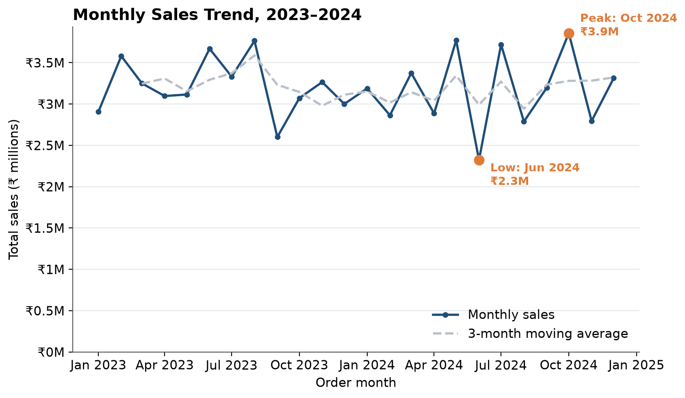

# 📊 Retail Sales – Data Visualization Project

Turning 7,000 retail transactions (2023–2024, four regions of India) into a visual story:
a cleaned dataset, 13 annotated charts with insight captions, a PDF report, and an **interactive Streamlit dashboard**.

**Live dashboard:** _paste your Streamlit Cloud link here after deploying_

## What's inside
| Path | Purpose |
|---|---|
| `app.py` | Interactive dashboard (4 filters, 5 KPIs, 14 interactive charts in 4 tabs) |
| `src/01_analysis_and_charts.py` | Data cleaning + all 13 charts + captions |
| `src/02_build_report.py` | Builds the PDF report from the charts |
| `notebooks/Retail_Data_Visualization.ipynb` | Same analysis, cell by cell |
| `report/Retail_Sales_Visual_Report.pdf` | Final visual report |
| `outputs/charts/` | The 13 chart images |
| `data/retail_customer_sales_dataset.csv` | Raw dataset (7,084 rows) |
| `data/cleaned_retail_data.csv` | Cleaned dataset (7,000 rows, used by `app.py`) |
| `outputs/cleaning_log.json` | Counts of every cleaning step |
| `docs/Major_Project_Report` | Full project report |
| `LICENSE` | MIT license |

## Run it
```bash
git clone https://github.com/<your-username>/<repo-name>.git
cd <repo-name>
pip install -r requirements.txt
streamlit run app.py                       # interactive dashboard
python src/01_analysis_and_charts.py       # re-create cleaned data + charts
python src/02_build_report.py              # re-create the PDF report
```

## Data cleaning
Mixed date formats (4 styles) parsed explicitly · Region/Gender spellings standardised · 84 duplicate rows removed ·
invalid Age (6), Discount (6), extreme Income (70) and impossible delivery dates (15) set to missing → **7,000 clean rows**.

## Key findings
- Sales are flat year on year (₹38.7M in 2023 vs ₹38.1M in 2024); monthly revenue swings between ₹2.3M and ₹3.9M.
- Electronics is 49% of sales; East is the strongest region, North the weakest.
- Profit tracks sales closely (margin ≈ 33%); customer age and income barely affect order value.
- ~12.6% of orders are returned; satisfaction is almost the same across delivery modes.

## Charts
| Type | Chart |
|---|---|
| Line | Monthly sales trend |
| Bar | Sales by region, sales by category, return rate |
| Histogram | Age, Income |
| Box plot | Profit by category |
| Scatter | Sales vs Profit, Discount vs Profit (with trend lines) |
| Donut | Sales share by customer segment |
| Heatmap | Correlation matrix, average sales category × region |
| Stacked bar | Satisfaction by delivery mode |



## Deploy on Streamlit Community Cloud
1. Push this repo to GitHub (public).
2. Open share.streamlit.io → **New app** → pick the repo, branch `main`, main file `app.py`.
3. Deploy, then paste the link at the top of this README.

## License
MIT – see [LICENSE](LICENSE).
